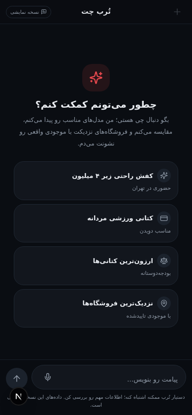
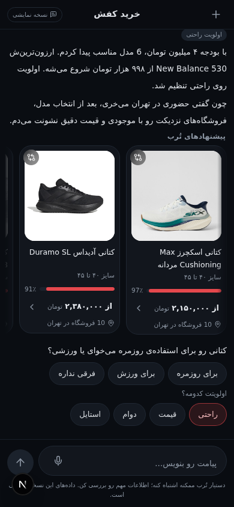
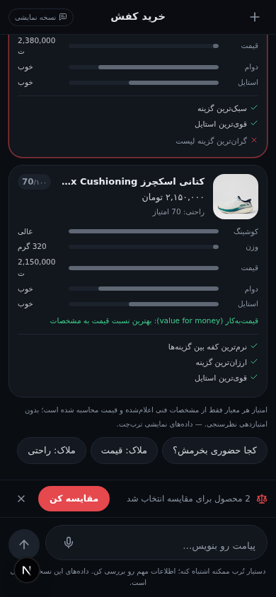
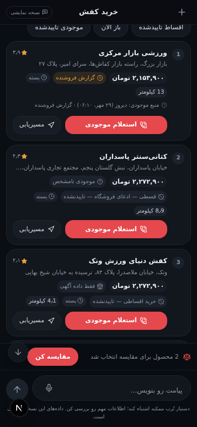
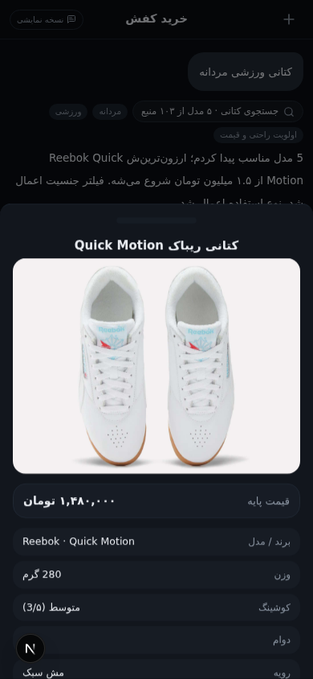

<div align="center">

# ترب‌یار — دستیار خرید هوشمند ترب

**چت‌محور · Generative-UI · فارسی و راست‌به‌چپ · موبایل‌اول · صداقت در داده**

کاربر به فارسی محاوره‌ای حرف می‌زند؛ دستیار محصول مناسب را پیدا می‌کند، مقایسه می‌کند،
فروشگاه‌های تهران را با فاصله واقعی می‌سنجد، سبد خرید می‌سازد، مسیر خرید چند‌فروشگاهی
را بهینه می‌کند — و همه‌چیز به‌شکل **کامپوننت‌های تعاملی تایپ‌شده** داخل خودِ چت رندر می‌شود.




</div>

---

## فهرست مطالب

1. [این پروژه چیست؟](#این-پروژه-چیست)
2. [ویژگی‌ها](#ویژگی‌ها)
3. [تصاویر محصول](#تصاویر-محصول)
4. [معماری](#معماری)
5. [ساختار کامل پروژه](#ساختار-کامل-پروژه)
6. [اتصال LLM — راهنمای کامل](#اتصال-llm--راهنمای-کامل)
7. [استقرار و دیپلوی — راهنمای گام‌به‌گام](#استقرار-و-دیپلوی--راهنمای-گامبهگام)
8. [مرجع REST API](#مرجع-rest-api)
9. [مدل صداقت داده](#مدل-صداقت-داده)
10. [تست و ارزیابی](#تست-و-ارزیابی)
11. [توسعه پروژه — افزودن قابلیت جدید](#توسعه-پروژه--افزودن-قابلیت-جدید)
12. [اعتبارها](#اعتبارها)

---

## این پروژه چیست؟

یک **دستیار خرید مولد (Generative Shopping Assistant)** برای پلتفرم ترب، که تجربه‌ی
خرید حضوری در تهران را از داخل یک گفت‌وگوی فارسی مدیریت می‌کند. این پروژه عمداً
یک «فروشگاه آنلاین» نیست — نه گرید محصول، نه دَش‌بورد؛ فقط یک چت که در لحظه‌های
درست، بلوک‌های تعاملی مناسب را تولید می‌کند.

سه ستون طراحی:

| ستون | یعنی چه؟ |
|---|---|
| **Chat-first** | همه‌چیز از متن فارسی شروع می‌شود: «یه کتونی زیر ۴ میلیون برای دویدن می‌خوام» |
| **Generative UI** | پاسخ‌ها متن خالی نیستند؛ کارت محصول، پنل مقایسه، نقشه فروشگاه‌ها، سبد خرید و مسیر بهینه، همگی به‌صورت کامپوننت تایپ‌شده داخل جریان چت رندر می‌شوند |
| **صداقت در داده** | هیچ قیمت، موجودی، مختصات، ساعت کاری یا زمان مسیرِ «از خودسازی‌شده‌ای» وجود ندارد؛ داده‌ی نمایشی صریحاً برچسب «نمایشی» می‌خورد و تخمین‌ها شفاف افشا می‌شوند |

معماری بک‌اند از ریپوی مرجع [TorobYar](https://github.com/yasinnazari/TorobYar)
(FastAPI + LangChain) الهام گرفته و با همان لایه‌بندی — `API → Agent → Services →
Repository` — به Next.js منتقل شده است.

---

## ویژگی‌ها

### موتور مکالمه دولایه

- **لایه ۱ — NLU قاعده‌محور (قطعی):** بیش از ۱۸ نیت فارسی (جست‌وجو، مقایسه، فروشگاه،
  اقساط، سبد خرید، مسیر، …) با نرمال‌سازی ارقام فارسی، اصلاح غلط املایی رایج
  (تومن/تومان) و slang فارسی (کتونی، مردونه، ارزون، کدونی…). بدون تاخیر، بدون توهم.
- **لایه ۲ — عامل LLM با حلقه ابزار:** فقط وقتی قواعد نتوانند پیام را طبقه‌بندی کنند
  فعال می‌شود؛ تا ۳ دور ابزار صدا می‌زند و خروجی‌اش یک **پاکت JSON سخت‌گیرانه** است
  (`intent` یا `reply`) که به همان ارکستراتور تایپ‌شده‌ی لایه ۱ می‌رود — یعنی مدل
  هیچ‌وقت مستقیم HTML تولید نمی‌کند.

### سبد خرید هوشمند (Smart Shopping Basket)

- افزودن محصول از کارت‌ها یا با زبان طبیعی: «این رو با سایز ۴۳ به سبد اضافه کن»،
  «هدف قیمتم ۲ میلیون»، «جوراب رو حذف کن»، «ارزون‌ترش رو پیدا کن»
- نمای سمت سرور (Server-truth) برای هر قلم: بهترین قیمت، فروشگاه منتخب، سطح
  اطمینان موجودی، مجموع تخمینی
- نوار سبد همیشه‌نمایان بالای ورودی + شیت ویرایش کامل (تعداد، حالت بهینه‌سازی،
  وسیله نقلیه، پاک‌کردن)

### سه نوع توصیه‌ی متناسب با بافت

| نوع | مثال | تضمین |
|---|---|---|
| مکمل (Complementary) | کفی برای کتونی راحتی | فقط «مرتبط از نظر معنایی» — برچسب‌گذاری شفاف |
| فرصت نزدیک (Nearby) | «همین جوراب‌ها در فروشگاهِ مسیرت هست» | فقط از داده‌ی موجودی واقعی |
| بهینه‌سازی سبد | «این قلم را در همان توقف فعلی بخر؛ ۳۰ هزار تومان کمتر» | با عدد قابل‌حساب |

هر توصیه **دلیل** خودش را می‌گوید، قابل رد شدن است (dismiss) و کلاً قابل خاموش‌کردن
است («دیگه پیشنهاد نده»).

### تخصیص چند‌فروشگاهی + بهینه‌سازی مسیر

- مقایسه‌ی ۴ استراتژی با توضیح تریدآف: **کمترین قیمت کل / کمترین زمان خرید /
  کمترین توقف / متعادل**
- موتور مسیر: شمارش دقیق زیرمجموعه‌ها (تا ۲^۱۰ فروشگاه)، مرتب‌سازی Nearest-Neighbor
  + بهبود 2-opt، مدل سفر افشا‌شده (ماشین ۲۰km/h / مترو و اتوبوس / پیاده ۴.۵km/h)،
  شبیه‌سازی ساعت ورود با پرچم «در زمان رسیدن بسته است»
- تابع هزینه‌ی نرمال‌شده و قابل‌پیکربندی:
  `Score = wT·زمان سفر + wD·مسافت + wC·هزینه خرید + wR·ریسک موجودی + wH·جریمه ساعات کاری`
- رندر نقشه SVG سبک + **فهرست توقف‌های همگام** (بدون اجبار به نقشه در موبایل)،
  جابه‌جایی/حذف توقف، محدود‌کردن فروشگاه، محاسبه‌ی مجدد پس از تغییر سبد

### بازیابی از خطا و عدم‌قطعیت

فروشگاه پاسخ نداد؟ در زمان رسیدن بسته است؟ موجودی نامشخص؟ دستیار مشکل را شفاف
می‌گوید، جایگزینِ سازگار با مسیر پیشنهاد می‌دهد، تفاوت قیمت/زمان را توضیح می‌دهد
و بقیه‌ی سبد و ترجیحات را دست‌نخورده نگه می‌دارد.

---

## تصاویر محصول

| | |
|---|---|
|  |  |
|  |  |

از راست به چپ در هر جفت: کارت‌های توصیه با عکس واقعی و امتیاز تطابق فارسی ·
پنل مقایسه با نوارهای معیار و برنده · فهرست فروشگاه‌های نزدیک با فاصله واقعی
(haversine) و اقدام تماس · کشوی جزئیات محصول.

---

## معماری

### نمای کلی

```
┌────────────────────────────────────────────────────────────────────┐
│                        Client (Next.js / React 19)                 │
│  chat-shell ─ composer ─ basket-bar ─ typing-indicator             │
│  chat-store (zustand + localStorage persist)                       │
│  generative/registry ──► 17 بلوک تایپ‌شده (zod-validated)           │
└──────────────┬──────────────────────────────┬──────────────────────┘
               │ POST /api/chat               │ POST /api/chat/action
               │ POST /api/products/* (REST)  │  (کلیک داخل بلوک‌ها)
┌──────────────▼──────────────────────────────▼──────────────────────┐
│                      Server (لایه‌بندی TorobYar)                    │
│                                                                    │
│  ┌── agent/runner ──────────────────────────────────────────────┐  │
│  │  Tier 1: lib/agent/nlu  (قواعد قطعی — همیشه اول)              │  │
│  │  Tier 2: LLM tool-loop  (فقط برای «unknown»)                 │  │
│  │          prompts ─ tools(zod) ─ پاکت JSON ─ mapIntent        │  │
│  └──────────────┬───────────────────────────────────────────────┘  │
│                 ▼                                                   │
│  lib/agent/orchestrator ──► ارکستراتور بلوک‌ها (تک منبع حقیقت UI)    │
│                 ▼                                                   │
│  ┌── services/ ─────────────────────────────────────────────────┐  │
│  │  product-service   جست‌وجوی وزن‌دار فارسی (پورت TorobYar)      │  │
│  │  shop-service      پیشنهاد/نزدیک/اقساط با یادداشت صداقت       │  │
│  │  conversation-memory  حافظه مکالمه سمت سرور (Prisma)          │  │
│  └──────────────┬───────────────────────────────────────────────┘  │
│                 ▼                                                   │
│  ┌── repositories/dataset ──────────────────────────────────────┐  │
│  │  تک منبع داده: کاتالوگ + فروشگاه‌ها + پیشنهادها               │  │
│  │  پرچم‌های صداقت: priceIsLive=false · straight_line فقط        │  │
│  └──────────────────────────────────────────────────────────────┘  │
│                                                                    │
│  lib/basket: route-engine (زیرمجموعه دقیق + 2-opt) · basket-view    │
│              recommendations (مکمل/نزدیک/بهینه‌سازی)                │
│  SQLite (Prisma): جدول Conversation — حافظه ۲۰ پیام آخر             │
└────────────────────────────────────────────────────────────────────┘
```

### چرا دولایه؟

| | لایه ۱ (قواعد) | لایه ۲ (LLM) |
|---|---|---|
| تاخیر | ~۱۸۰ms | ۲–۱۴s |
| توهم | صفر | مهارشده با ابزار + پاکت JSON |
| پوشش | همه نیت‌های شناخته‌شده | هر جمله فارسی آزاد |
| هزینه | صفر | فقط وقتی لازم است |

نکته‌ی کلیدی: خروجی لایه ۲ هرگز مستقیم به UI نمی‌رود. مدل یا یک **نیت شناخته‌شده**
برمی‌گرداند که از همان `route()` قطعی عبور می‌کند، یا یک **پاسخ متنی آزاد** برای
موضوعات چت‌محور (مشاوره سایز، نگهداری کتانی، گپ). هر ادعای محصول/قیمت/موجودی
باید با نتیجه‌ی یک ابزار که سمت سرور اجرا شده «زمین‌گیر» شده باشد.

### بلوک‌های Generative-UI (۱۷ عدد)

`product-card` · `product-details` · `comparison-panel` · `store-card` ·
`store-panel` · `store-map` · `contact-status` · `alternative-stores` ·
`search-context` · `quick-replies` · `preference-selector` · `empty-state` ·
`status-badges` · `basket-summary` · `basket-recs` · `route-plan` · `plan-comparison`

هر بلوک: اسکیمای zod سمت سرور → رجیستری سمت کلاینت → کامپوننت shadcn/ui.
**هیچ HTML/JS دلخواهِ تولیدشده‌ی مدل به DOM نمی‌رسد.**

---

## ساختار کامل پروژه

```
.
├── src/
│   ├── app/                              # مسیرهای Next.js (App Router)
│   │   ├── api/
│   │   │   ├── chat/route.ts             # POST پیام چت — پایپ‌لاین اصلی:
│   │   │   │                             #   memory → resolveTurn → route → memory → blocks
│   │   │   ├── chat/action/route.ts      # POST اکشن‌های داخل بلوک‌ها (افزودن به سبد، حذف توقف…)
│   │   │   ├── health/route.ts           # آمار دیتاست + وضعیت عامل
│   │   │   └── products/
│   │   │       ├── search/route.ts       # GET جست‌وجو (?q=&budget=&gender=&use_case=&priorities=)
│   │   │       └── [id]/
│   │   │           ├── offers/route.ts   # GET همه پیشنهادهای قیمت یک محصول
│   │   │           ├── nearby/route.ts   # GET فروشگاه‌های نزدیک (?lat=&lng=&radius=)
│   │   │           └── payment-shops/route.ts  # GET فروشگاه‌های اقساط
│   │   ├── layout.tsx                    # فونت Vazirmatn + dir=rtl
│   │   └── page.tsx                      # شروع چت
│   │
│   ├── components/
│   │   ├── chat/                         # پوسته چت
│   │   │   ├── chat-shell.tsx            #   اسکرول، jump-FAB، رندر بلوک‌ها
│   │   │   ├── composer.tsx              #   ورودی پیام (مرکز‌عمودی تایید‌شده + رشد چندخطی)
│   │   │   ├── hero.tsx                  #   صفحه خوش‌آمد با سناریوهای پیشنهادی
│   │   │   ├── basket-bar.tsx            #   نوار فشرده سبد + شیت ویرایش
│   │   │   ├── conversation-message.tsx  #   حباب پیام + پارس بلوک‌ها
│   │   │   └── typing-indicator.tsx
│   │   ├── generative/
│   │   │   ├── registry.tsx              # رجیستری type→component (تنها دروازه DOM)
│   │   │   ├── ui.tsx                    # پریمیتیوهای مشترک (Pill/Tag/SectionTitle روی shadcn)
│   │   │   └── blocks/                   # ۱۷ بلوک تعاملی
│   │   └── ui/                           # shadcn/ui (Button, Card, Badge, Drawer, Sheet…)
│   │
│   ├── lib/                              # هسته دامنه — بدون وابستگی به فریم‌ورک
│   │   ├── agent/
│   │   │   ├── nlu.ts                    # لایه ۱: NLU قطعی فارسی (نیت + موجودیت)
│   │   │   ├── orchestrator.ts           # route(): نیت → بلوک‌های تایپ‌شده (تک منبع حقیقت)
│   │   │   └── tools.ts                  # ابزارهای سمت ارکستراتور
│   │   ├── basket/
│   │   │   ├── route-engine.ts           # موتور مسیر: زیرمجموعه دقیق + NN + 2-opt + امتیاز
│   │   │   ├── basket-view.ts            # نمای server-truth سبد
│   │   │   └── recommendations.ts        # ۳ نوع توصیه با دلیل
│   │   ├── data/
│   │   │   ├── catalog.ts                # ۱۰ مدل کتانی واقعی + ۵ لوازم جانبی (عکس واقعی)
│   │   │   └── stores.ts                 # ۱۰ فروشگاه نمایشی تهران با مختصات واقعیِ نقاط شاخص
│   │   ├── scoring.ts                    # تابع امتیاز مقایسه محصول
│   │   ├── geo.ts                        # haversine + فرمت فاصله فارسی
│   │   ├── format.ts                     # ارقام فارسی، تومان، تاریخ
│   │   ├── block-schema.ts               # اسکیمای zod همه بلوک‌ها + اکشن‌ها
│   │   ├── types.ts                      # انواع دامنه (Context, BasketItem, RoutePlan…)
│   │   └── db.ts                         # کلاینت Prisma
│   │
│   ├── server/                           # بک‌اند لایه‌بندی‌شده به سبک TorobYar
│   │   ├── core/config.ts                # تک‌جا برای همه رفتارها (نه پراکنده از env)
│   │   ├── agent/
│   │   │   ├── prompts.ts                # پرامپت صداقت + قرارداد پاکت JSON
│   │   │   ├── tools.ts                  # ۷ ابزار zod-دار برای حلقه LLM
│   │   │   └── runner.ts                 # resolveTurn: لایه ۱ → لایه ۲ → commit اجباری
│   │   ├── repositories/dataset.ts       # تک منبع داده + پرچم‌های صداقت
│   │   └── services/
│   │       ├── product-service.ts        # جست‌وجوی وزن‌دار فارسی (پورت TorobYar)
│   │       ├── shop-service.ts           # پیشنهاد/نزدیک/اقساط
│   │       └── conversation-memory.ts    # حافظه سمت سرور (fallback کلاینت سرد)
│   │
│   └── store/chat-store.ts               # zustand: context + basket + persist
│
├── prisma/schema.prisma                  # مدل Conversation (حافظه مکالمه)
├── docs/screenshots/                     # تصاویر README
├── scripts/                              # پروب و تست
│   ├── basket-smoke.sh                   # تست دودی API سبد (end-to-end)
│   ├── llm-probe.ts                      # بررسی مستقیم LLM + قرارداد پاکت
│   └── runner-probe.ts                   # بررسی runner دولایه
├── db/custom.db                          # SQLite (حافظه مکالمه)
├── next.config.ts                        # output: "standalone"
└── package.json                          # اسکریپت‌های dev/build/start/db
```

---

## اتصال LLM — راهنمای کامل

### ۱. اتصال فعلی چگونه است؟

پروژه از **`z-ai-web-dev-sdk`** (مدل GLM) استفاده می‌کند. ویژگی‌های این اتصال:

- **فقط سرور:** SDK فقط در `src/server/agent/runner.ts` import می‌شود. کلید و
  توکن‌ها را SDK خودش به‌صورت داخلی مدیریت می‌کند و **هیچ کلیدی به باندل کلاینت
  نمی‌رسد**.
- **فراخوانی استاندارد Chat Completions:**

```ts
// src/server/agent/runner.ts
import ZAI from "z-ai-web-dev-sdk";

const zai = await ZAI.create();

const completion = await zai.chat.completions.create({
  messages,                          // پرامپت سیستم + تاریخچه + پیام کاربر
  thinking: { type: "disabled" },    // پاسخ سریع؛ استدلال در پرامپت هدایت می‌شود
});
const content = completion.choices[0]?.message?.content ?? "";
```

- **قرارداد خروجی (پاکت JSON):** مدل موظف است فقط یکی از این سه شکل را برگرداند:

```jsonc
// الف) درخواست ابزار — نتیجه به دور بعد برمی‌گردد
{ "action": "tool_call", "tool": "search_products", "args": { "query": "کتانی دویدن", "budget_max": 4000000 } }

// ب) تصمیم نهایی به‌شکل نیت — به ارکستراتور قطعی می‌رود
{ "action": "intent", "intent": "search", "entities": { "budgetMax": 4000000, "useCase": "sport" } }

// ج) پاسخ متنی آزاد — فقط برای موضوعات چت‌محور
{ "action": "reply", "reply": "برای دویدن روزانه، سایز نیم‌سانت بزرگ‌تر معمولاً راحت‌تر است…" }
```

- **ابزارهای در دسترس مدل** (همگی zod-اعتبارسنجی و سمت سرور اجرا می‌شوند):

| ابزار | کار |
|---|---|
| `search_products` | جست‌وجوی وزن‌دار فارسی کاتالوگ |
| `get_product_offers` | همه قیمت‌های یک محصول بین فروشگاه‌ها |
| `find_nearby_product_shops` | فروشگاه‌های نزدیک به مختصات کاربر |
| `find_payment_shops` | فروشگاه‌های دارای اقساط |
| `find_similar_products` | مشابه‌ها برای «ارزون‌تر پیدا کن» |
| `get_basket` | وضعیت فعلی سبد |
| `update_shopping_preferences` | ثبت ترجیحات (بودجه، جنسیت، اولویت‌ها) |

### ۲. رفتار دولایه را تنظیم کنید

همه‌ی تنظیمات در `src/server/core/config.ts` است — **هیچ جایی جز این ماژول
`process.env` نمی‌خواند**:

```ts
export const SERVER_CONFIG = {
  agent: {
    enabled: process.env.AGENT_LLM_DISABLED !== "1", // 1 = فقط لایه قواعد
    maxToolRounds: 3,        // حداکثر دور ابزار در هر پیام
    timeoutMs: 14_000,       // سقف زمانی کل حلقه
  },
  memory: { maxMessages: 20 }, // حافظه مکالمه سمت سرور
  search: { defaultLimit: 6, maxLimit: 20 },
} as const;
```

با `AGENT_LLM_DISABLED=1` در `.env`، برنامه کاملاً بدون LLM کار می‌کند
(حالت قواعد-فقط) — برای توسعه آفلاین و صرفه‌جویی در هزینه.

### ۳. تست اتصال

```bash
# بررسی مستقیم مدل + انطباق با پاکت JSON
bun scripts/llm-probe.ts

# بررسی حلقه دولایه (قواعد → ابزار → commit)
bun scripts/runner-probe.ts
```

### ۴. اتصال مدل دیگر (OpenAI-compatible)

اگر می‌خواهید به جای SDK از سرویس دیگری (مثلاً یک endpoint سازگار با OpenAI)
استفاده کنید، فقط `runner.ts` را تغییر دهید — بقیه سیستم (پرامپت، ابزار، پاکت
JSON، ارکستراتور) بدون تغییر می‌ماند:

```ts
// src/server/agent/runner.ts — فقط این تابع را عوض کنید
async function chatCall(messages: ChatMsg[]): Promise<string> {
  const res = await fetch("https://api.your-provider.com/v1/chat/completions", {
    method: "POST",
    headers: {
      "Content-Type": "application/json",
      Authorization: `Bearer ${process.env.LLM_API_KEY}`, // فقط سمت سرور
    },
    body: JSON.stringify({ model: process.env.LLM_MODEL, messages }),
  });
  const data = await res.json();
  return data.choices[0]?.message?.content ?? "";
}

// سپس در llmLoop و commit نهایی:
// const content = await withTimeout(chatCall(messages), SERVER_CONFIG.agent.timeoutMs, "llm");
```

**چک‌لیست سازگاری مدل جدید:**

- [ ] خروجی JSON پایدار می‌دهد؟ (در غیر این صورت `extractJson` را مقاوم‌تر کنید)
- [ ] پرامپت فارسی را خوب می‌فهمد؟ (پروب `llm-probe.ts` را بزنید)
- [ ] Response time زیر سقف `timeoutMs` است؟
- [ ] کلید فقط در سرور است؟ (هرگز `NEXT_PUBLIC_` برای کلید استفاده نکنید)

---

## استقرار و دیپلوی — راهنمای گام‌به‌گام

### پیش‌نیازها

| ابزار | نسخه | توضیح |
|---|---|---|
| Node.js | ≥ 20 | یا Bun ≥ 1.3 (توصیه‌شده) |
| Bun | ≥ 1.3 | برای اسکریپت `start` و پروب‌ها |
| حافظه | ≥ 512MB | برنامه سبک است؛ LLM سمت سرویسِ SDK اجرا می‌شود |

### گام ۱ — کلون و نصب

```bash
git clone <repo-url> torobyar-assistant
cd torobyar-assistant

# با Bun (توصیه‌شده — سریع‌ترین)
bun install

# یا با npm
npm install
```

### گام ۲ — متغیرهای محیطی

فایل `.env` در ریشه بسازید:

```bash
# الزامی — مسیر دیتابیس SQLite (حافظه مکالمه)
DATABASE_URL="file:./db/custom.db"

# اختیاری — خاموش‌کردن لایه LLM (فقط قواعد)
AGENT_LLM_DISABLED=0
```

> توضیح: اعتبارنامه‌های LLM توسط `z-ai-web-dev-sdk` به‌صورت داخلی از محیط
> اجرا خوانده می‌شوند؛ کلیدی در کد یا باندل کلاینت وجود ندارد. اگر سرویس
> دیگری وصل می‌کنید (بخش اتصال LLM ↑)، کلید را در همین `.env` با نام
> `LLM_API_KEY` بگذارید.

### گام ۳ — دیتابیس

```bash
# ساخت/به‌روزرسانی جدول‌ها (SQLite — بدون سرور اضافه)
bun run db:push
# یا: bun run db:generate && bun run db:migrate
```

### گام ۴ — توسعه محلی

```bash
bun run dev          # http://localhost:3000
```

### گام ۵ — بیلد پروداکشن

پروژه از `output: "standalone"` استفاده می‌کند؛ اسکریپت build فایل‌های static
و public را داخل خروجی standalone کپی می‌کند:

```bash
bun run build        # next build + کپی static/public داخل standalone
bun run start        # NODE_ENV=production bun .next/standalone/server.js
```

با Node خالص (بدون Bun):

```bash
NODE_ENV=production node .next/standalone/server.js
```

### گام ۶ — سرویس systemd (VPS لینوکس)

`/etc/systemd/system/torobyar.service`:

```ini
[Unit]
Description=TorobYar Shopping Assistant (Next.js)
After=network.target

[Service]
Type=simple
User=www-data
WorkingDirectory=/opt/torobyar-assistant
Environment=NODE_ENV=production
Environment=DATABASE_URL=file:/opt/torobyar-assistant/db/custom.db
# Environment=AGENT_LLM_DISABLED=0
ExecStart=/usr/bin/node /opt/torobyar-assistant/.next/standalone/server.js
Restart=always
RestartSec=3

[Install]
WantedBy=multi-user.target
```

```bash
sudo systemctl daemon-reload
sudo systemctl enable --now torobyar
sudo systemctl status torobyar
```

### گام ۷ — داکر (اختیاری)

`Dockerfile` نمونه (خروجی standalone حجم کم می‌دهد):

```dockerfile
FROM oven/bun:1 AS deps
WORKDIR /app
COPY package.json bun.lock ./
RUN bun install --frozen-lockfile

FROM oven/bun:1 AS builder
WORKDIR /app
COPY --from=deps /app/node_modules ./node_modules
COPY . .
RUN bun run build

FROM oven/bun:1-slim AS runner
WORKDIR /app
ENV NODE_ENV=production
ENV DATABASE_URL=file:/app/db/custom.db
# پوشه دیتابیس را به‌صورت volume سوار کنید تا حافظه مکالمه باقی بماند
COPY --from=builder /app/.next/standalone ./
COPY --from=builder /app/db ./db

EXPOSE 3000
CMD ["bun", "./server.js"]
```

```bash
docker build -t torobyar .
docker run -d -p 3000:3000 -v torobyar-db:/app/db --name torobyar torobyar
```

### گام ۸ — Reverse Proxy

نمونه Caddy (ساده‌ترین — گواهی SSL خودکار):

```
your-domain.com {
    reverse_proxy localhost:3000
}
```

نمونه Nginx:

```nginx
server {
    listen 443 ssl http2;
    server_name your-domain.com;

    location / {
        proxy_pass http://127.0.0.1:3000;
        proxy_set_header Host $host;
        proxy_set_header X-Forwarded-For $remote_addr;
        proxy_set_header X-Forwarded-Proto $scheme;
        proxy_http_version 1.1;
    }
}
```

### نکات مهم پروداکشن

- **SQLite = فایل محلی.** در داکر حتماً volume بدهید؛ در چند‌ریپلیکا از
  SQLite دور شوید (یا `DATABASE_URL` را به Postgres ببرید و provider اسکیمای
  Prisma را عوض کنید — تنها مدل فعلی `Conversation` است).
- **حافظه مکالمه سمت سرور** است (جدول Conversation): پاک‌شدن دیتابیس یعنی
  فراموشی مکالمه‌ها؛ سبد خرید کلاینت هم در localStorage ذخیره می‌شود.
- **سقف زمانی LLM** (۱۴ ثانیه) روی سرورهای کند را در `config.ts` بالا ببرید.
- لاگ‌ها: `dev.log` / `server.log` (اسکریپت‌ها tee می‌کنند) + `[runner]` در stdout.
- سنجش سلامت: `GET /api/health` برای uptime monitor.

---

## مرجع REST API

| متد | مسیر | کار |
|---|---|---|
| POST | `/api/chat` | پیام چت — کل پایپ‌لاین (نیت → بلوک‌ها → سبد) |
| POST | `/api/chat/action` | اکشن‌های بلوک‌ها (افزودن/حذف سبد، جابه‌جایی توقف…) |
| GET | `/api/products/search` | جست‌وجوی فارسی وزن‌دار |
| GET | `/api/products/:id/offers` | همه قیمت‌های محصول بین فروشگاه‌ها |
| GET | `/api/products/:id/nearby` | فروشگاه‌های نزدیک (فاصله خط مستقیم — افشا‌شده) |
| GET | `/api/products/:id/payment-shops` | فروشگاه‌های اقساط |
| GET | `/api/health` | آمار دیتاست + وضعیت عامل |

نمونه‌ها:

```bash
# جست‌وجو با فیلترها
curl "http://localhost:3000/api/products/search?q=کتانی+راحتی&budget=4000000&use_case=daily&limit=5"

# فروشگاه‌های نزدیک (سعادت‌آباد) تا شعاع ۵ کیلومتر
curl "http://localhost:3000/api/products/p-01/nearby?lat=35.7833&lng=51.3834&radius=5"

# سلامت سرویس
curl http://localhost:3000/api/health
```

پاسخ `/api/chat` شامل متن + آرایه بلوک‌های تایپ‌شده + `basketView` + متادیتای
منبع تصمیم (`rules | llm-intent | llm-reply | fallback`) است — دقیقاً همان
چیزی که رابط چت رندر می‌کند.

---

## مدل صداقت داده

این بخش «غیرقابل‌مذاکره» است و در پرامپت عامل هم عیناً تکرار شده:

| قانون | پیاده‌سازی |
|---|---|
| قیمت‌های ثبت‌شده لحظه‌ای نیستند | `priceIsLive=false` در دیتاست + یادداشت در UI |
| وجود در کاتالوگ ≠ موجودی قطعی | ۴ سطح: `confirmed / reported / listing-only / unknown` |
| فاصله‌ها خط مستقیم‌اند، نه مسیر رانندگی | haversine + برچسب صریح در UI و پاسخ‌ها |
| زمان سفر تخمین مدلِ افشاشده است، نه داده واقعی | «~۲۰km/h» در پانوشت مسیر |
| تماس/تایید فروشنده جعل نمی‌شود | نتایج تماس برچسب «شبیه‌سازی» |
| داده نمایشی باید صریح اعلام شود | فروشگاه‌ها «نمایشی»؛ مختصات نقاط شاخص واقعی |
| ادعای مدل بدون ابزار مسدود است | پاکت JSON + اجرای ابزار فقط سمت سرور |

---

## تست و ارزیابی

```bash
# تست دودی کامل API (جست‌وجو، سبد، مسیر، اکشن‌ها)
bash scripts/basket-smoke.sh

# پروب LLM و runner
bun scripts/llm-probe.ts
bun scripts/runner-probe.ts

# لینت و تایپ
bun run lint
```

**سناریوهای پذیرش (هر ۱۰ مورد سبز):** سبد چند‌دسته‌ای · همپوشانی فروشگاه‌های
نزدیک · دور زدن فروشگاه ارزانِ دور · موجودی تاییدنشده · فروشگاه بسته/بی‌پاسخ ·
محصولات هم‌مجتمع · تغییر سبد پس از مسیر · تعویض حالت سریع‌ترین/ارزان‌ترین ·
توصیه مرتبط بدون موجودی نزدیک · سفر فشرده موبایل.

پوشش E2E مرورگر: hero → جست‌وجو (بودجه ۴M، عکس واقعی) → مقایسه ×۲ با تعویض
معیار → کشف فروشگاه با نقشه SVG و فاصله واقعی → شبیه‌سازی تماس (پاسخ/بی‌پاسخ →
جایگزین‌ها) → افزودن به سبد → مسیر ۴ حالته → تغییر سبد و محاسبه مجدد →
persist پس از reload → ریست چت جدید.

---

## توسعه پروژه — افزودن قابلیت جدید

| می‌خواهید… | این فایل‌ها را تغییر دهید |
|---|---|
| محصول جدید | `lib/data/catalog.ts` |
| فروشگاه/موجودی جدید | `lib/data/stores.ts` |
| نیت فارسی جدید | `lib/agent/nlu.ts` + `lib/agent/orchestrator.ts` |
| ابزار جدید برای LLM | `server/agent/tools.ts` (zod) + `server/agent/prompts.ts` |
| بلوک UI جدید | `lib/block-schema.ts` + `components/generative/blocks/*` + `registry.tsx` |
| اکشن بلوک جدید | `block-schema.ts` + `api/chat/action/route.ts` + هندلر ارکستراتور |
| تغییر وزن‌های مسیر | `lib/basket/route-engine.ts` (wT/wD/wC/wR/wH) |
| تنظیم رفتار سرور | فقط `server/core/config.ts` |

قاعده طلایی: **UI هرگز از خودش داده نمی‌سازد** — هر بلوک، خروجی zod-دار سرور است
و هر ادعا از دیتاست یا نتیجه ابزار می‌آید.

---

## اعتبارها

- **[TorobYar](https://github.com/yasinnazari/TorobYar)** — ریپوی مرجع بک‌اند
  (FastAPI + LangChain + SQLite)؛ لایه‌بندی، پرامپت صداقت و جست‌وجوی وزن‌دار
  فارسی از آن پورت شده است.
- **[z-ai-web-dev-sdk](https://www.npmjs.com/package/z-ai-web-dev-sdk)** — اتصال
  مدل GLM (فقط سمت سرور).
- **[shadcn/ui](https://ui.shadcn.com/)** + **Radix UI** — پریمیتیوهای رابط،
  راست‌به‌چپ‌سازی‌شده.
- **[Vazirmatn](https://github.com/rastikerdar/vazirmatn)** — فونت فارسی.
- **Next.js 16 · React 19 · Tailwind 4 · Prisma 6 · zustand · zod**
- داده‌های محصول/فروشگاه **نمایشی** است و در UI صریحاً برچسب‌گذاری شده؛ مختصات
  نقاط شاخص تهران (مجری‌ها و مراکز خرید) واقعی است.
